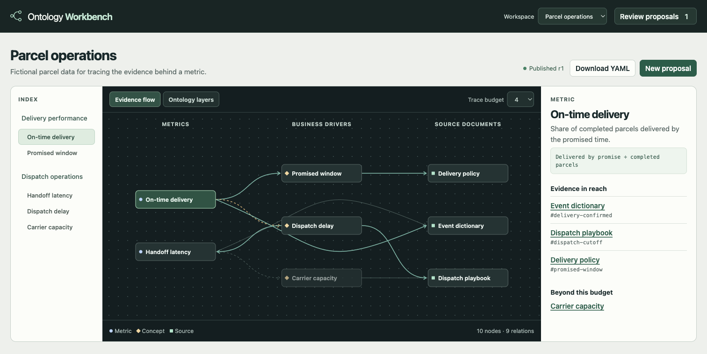
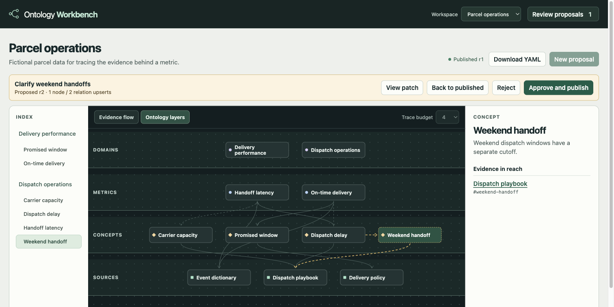

# Ontology Workbench

**Trace a metric from its definition to the source documents behind it.**

Explore domains, concepts, metrics and references in one graph. The browser and MCP clients read the same published revision. A human review turns a proposed patch into the next version.

[简体中文](README.md) · [Architecture and schema](docs/ARCHITECTURE.md) · [Local access and MCP](docs/LOCAL_ACCESS.md)



The screenshot uses a fictional parcel dataset from the running example.

## Run the example

Install **Go 1.25+**, then run:

```sh
git clone https://github.com/shanghe000/ontology-workbench.git
cd ontology-workbench
go run ./cmd/workbench -demo
```

Open <http://127.0.0.1:8080>. Choose **On-time delivery** and open **Event dictionary** to read the `delivery-confirmed` section. Raise the traversal budget to 6 to reach a different anchor in the same document via **Handoff latency**. Under **Review proposals**, preview and approve **Clarify weekend handoffs** to publish revision `r2`.



## What is implemented

- **Evidence tracing.** A bounded weighted traversal follows directed relations. Evidence edges have lower cost than business relations. Each reference carries a repository alias, relative file path and optional anchor.
- **Versioned review.** Each patch targets a published base revision, retries have a request ID, and approval advances the SQLite head in the same transaction as the review receipt.
- **Workspace-scoped MCP.** Read tokens retrieve published graphs and evidence traces. Proposal tokens add proposals to the review queue.
- **Optional DeepSeek drafting.** With explicit consent, DeepSeek receives the instruction and graph metadata and produces a validated, editable patch. The verification suite uses a local test double for the provider.

See [local access](docs/LOCAL_ACCESS.md) for persistent workspaces, bearer scopes, and the optional model configuration.

[Contributing](CONTRIBUTING.md) · [Security](SECURITY.md) · [MIT license](LICENSE)
