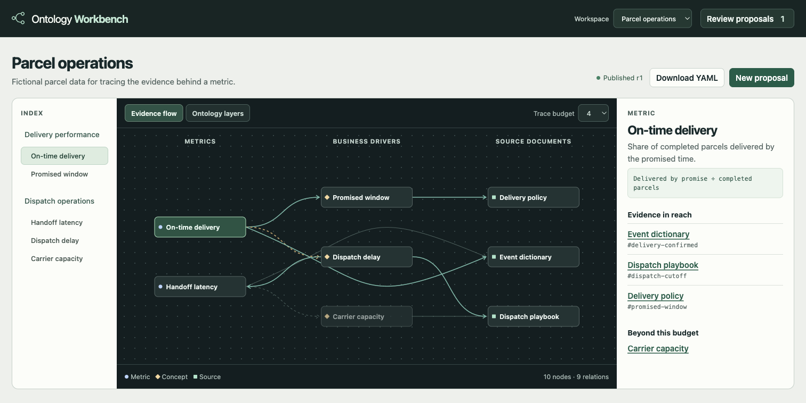
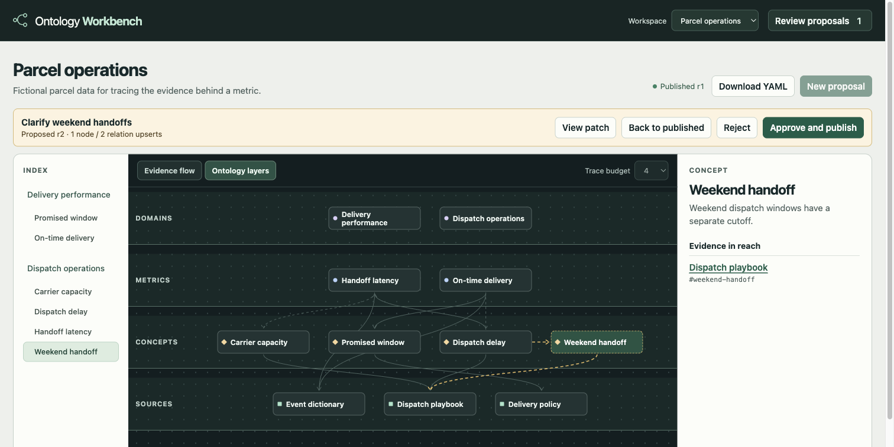
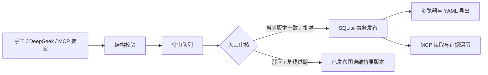

# Ontology Workbench · 知识本体工作台

**从一个指标出发，沿图谱追到它的计算口径和原文出处。**

工作台管理领域、概念、指标和资料索引。浏览器和 MCP 客户端共享同一个已发布图谱。人工或 DeepSeek 可起草变更，审核通过后才产生新版本。

[English](README.en.md) · [运行演示](#运行演示) · [架构与字段](docs/ARCHITECTURE.md) · [本地访问与 MCP](docs/LOCAL_ACCESS.md)



*实际运行截图，使用虚构的包裹配送资料。*

## 运行演示

需要 **Go 1.25+**。前端随 Go 二进制打包，安装完成后，演示无需模型密钥或外部服务。

```sh
git clone https://github.com/shanghe000/ontology-workbench.git
cd ontology-workbench
go run ./cmd/workbench -demo
```

打开 <http://127.0.0.1:8080>，试走两条路径：

1. **查指标。** 选择 **On-time delivery**，在右侧点 **Event dictionary** 打开 `delivery-confirmed` 段。把 **Trace budget** 从 4 改到 6，同一份字典还能通过 **Handoff latency** 指向 `carrier-accepted` 段。不同关系各自保留定位。
2. **审变更。** 点击 **Review proposals → Open preview**，再选 **Ontology layers**。虚线标记新增的 **Weekend handoff** 与相关箭头。点 **View patch** 核对变更，点 **Approve and publish** 后，已发布图谱从 `r1` 变成 `r2`。重启演示会恢复初始样例。



## 设计



| 能力 | 实现 |
| --- | --- |
| **证据遍历** | 有向加权遍历优先查定义和观测证据。预算与节点上限约束展开范围，超出范围的下一跳仍可见。 |
| **文档定位** | 仓库别名和相对路径定位资料，每条关系可指向不同锚点。通用接口处理索引元数据，样例的原文由浏览器单独查看。 |
| **审核版本** | 基于版本提交补丁，同一请求可安全重试。SQLite 事务统一更新图谱和审核状态，旧版本保留。 |
| **MCP** | 凭据按空间和用途分开。读取和证据遍历只查发布版本，提交凭据可以排队待审。 |
| **DeepSeek** | 可选的结构化草稿。用户确认发送指令和当前图谱元数据后，模型提供可编辑补丁。服务校验图结构和引用锚点。 |

持久化工作区、MCP 安装和 DeepSeek 配置见 [本地访问与 MCP](docs/LOCAL_ACCESS.md)。此版本面向本机工作区。测试中的模型回包由本地替身提供。

```sh
go test -race ./...
go vet ./...
go build ./cmd/workbench
```

[贡献指南](CONTRIBUTING.md) · [安全政策](SECURITY.md) · [MIT 许可](LICENSE)
